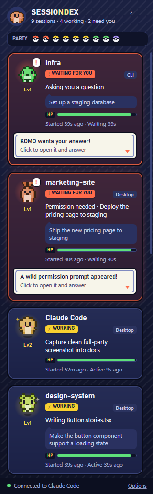

# Sessiondex

**A Pokémon-style party screen for your Claude Code sessions.**

Sessiondex docks a slim panel to the right edge of your Windows screen. Every Claude Code session you have running, in a terminal or in the Claude desktop app, gets a card with its own pixel critter, showing what Claude is doing right now.

- **Working** critters hop.
- **Waiting for you** critters shake and pop a "!" bubble, and you get a Windows notification.
- **Finished** critters do a little victory spin.
- **Idle** critters fall asleep.

Click a card to jump straight into that session.



## Features

- **Live status for every session:** Working, Waiting for you, Finished or Idle, plus what it's doing in plain words ("Editing app.js", "Run the test suite").
- **Knows when you're needed:** permission prompts and questions highlight the card, and you get a notification. You also get a notification when a long job finishes.
- **Click to open:** desktop sessions open directly, and CLI sessions bring their terminal to the front.
- **CLI and desktop:** each card shows where its session came from, plus the project folder, git branch and your last prompt.
- **Mini mode:** push the dock in to a 64px strip of critters, where only the ones with news move.
- **Comfort options:** Compact cards, Calm mode (no looping motion; follows the Windows animation setting) and Plain wording (for screen sharing).
- **Stays out of the way:** it docks like the taskbar, so windows resize around it instead of being covered.

## Requirements

- Windows 10 or 11
- [Claude Code](https://code.claude.com) (CLI and/or desktop app)
- [Node.js](https://nodejs.org) (runs the tiny hook script)
- [.NET 10 Desktop Runtime](https://dotnet.microsoft.com/download/dotnet/10.0) for the release zip, or the .NET 10 SDK to build from source

## Install

**From a release:** download `Sessiondex-win-x64.zip` from [Releases](../../releases), check its SHA-256 against the release notes, and extract it somewhere like `%LOCALAPPDATA%\Programs\Sessiondex`.

**Or build from source:**

```powershell
git clone https://github.com/paragpandyareal/sessiondex
cd sessiondex
dotnet publish AgentDock.csproj -c Release -o "$env:LOCALAPPDATA\Programs\Sessiondex"
```

**Then connect it to Claude Code (one time):**

```powershell
& "$env:LOCALAPPDATA\Programs\Sessiondex\AgentDock.exe" --install-hooks
```

This backs up `~/.claude/settings.json` and adds one hook entry per event. Nothing else in the file changes. Restart any running Claude Code sessions afterwards. To undo it, run `--uninstall-hooks`.

**Run it:**

```powershell
& "$env:LOCALAPPDATA\Programs\Sessiondex\AgentDock.exe"
```

To start it with Windows, put a shortcut to `AgentDock.exe` in `shell:startup`.

## Privacy and security

Everything stays on your machine: no telemetry, no network calls, no admin rights. The app listens on `127.0.0.1` only, behind a per-install secret token. See [SECURITY.md](SECURITY.md) for exactly what it touches and how the listener is protected.

## How it works

Claude Code [hooks](https://code.claude.com/docs/en/hooks) run `hook/agent-dock-hook.js` on each session event. The script trims the event and posts it to the app on localhost. It runs asynchronously and always exits within 1 second, so it never slows Claude down. The app turns those events into cards.

Debugging: the log is at `%LOCALAPPDATA%\AgentDock\agentdock.log`.

## Credits

The critters are original, procedurally generated pixel art. Sessiondex is a fan-made homage to the party screens of handheld monster games. It isn't affiliated with Nintendo, Game Freak or The Pokémon Company, or with Anthropic.

MIT licensed.
