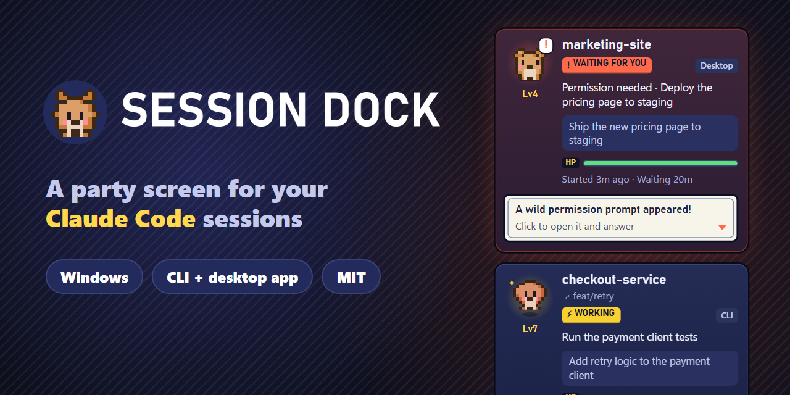
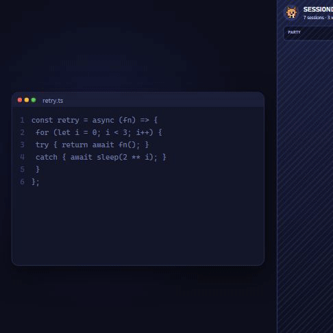
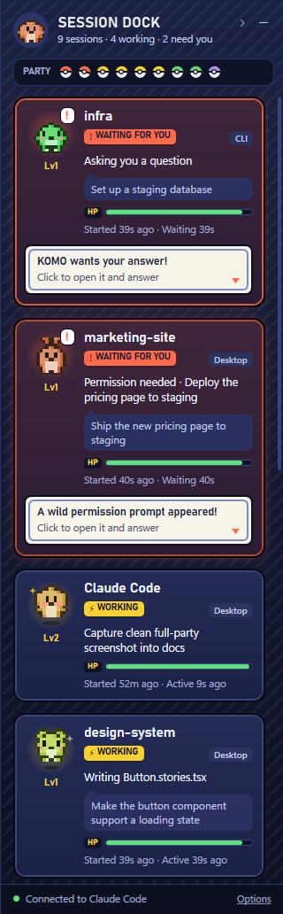
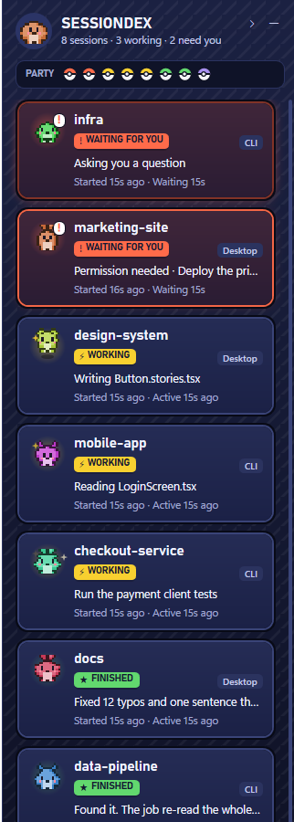
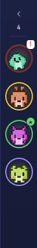

<p align="center">
  
</p>

<p align="center">
  <a href="https://github.com/paragpandyareal/session-dock/releases/latest"></a>
  <a href="https://github.com/paragpandyareal/session-dock/actions/workflows/build.yml"></a>
  <a href="https://github.com/paragpandyareal/session-dock/actions/workflows/codeql.yml"></a>
  
  <a href="LICENSE"></a>
</p>

<p align="center">
  <b>Every Claude Code session gets a pixel critter.</b><br>
  Working critters hop. Finished ones do a victory spin. Idle ones fall asleep.<br>
  The one that needs you shakes, shouts "!" and pings Windows until you look.
</p>

<p align="center">
  
</p>

<p align="center">
  <a href="docs/session-dock-demo.mp4"><b>▶ Watch the 50-second demo (with sound)</b></a>
</p>

---

## Why

If you run more than two Claude Code sessions at once, you know the feeling. One of them has been sitting at "Do you want to proceed?" for twenty minutes, in the terminal tab you can't see.

Session Dock docks a slim panel to the right edge of your screen, like the taskbar but vertical, and shows every session at a glance: what it's doing, what you last asked it, and whether it's waiting on you. It works with the Claude Code **CLI** and the **Claude desktop app**, side by side.

## Features

| | |
|---|---|
| 🟡 **Live status** | Working, Waiting for you, Finished or Idle. It says what Claude is doing in plain words ("Editing app.js", "Run the test suite"), not raw commands. |
| 🔴 **Knows when you're needed** | Permission prompts and questions turn the card red, pop a "!" and send a Windows notification. You also get one when a long job finishes. |
| 🖱️ **Click to jump in** | Click a card and you're in that session. Desktop sessions open directly, and CLI sessions bring their terminal to the front. |
| 🏷️ **Context on every card** | Project folder, git branch, CLI or Desktop label, your last prompt, and how long it's been running. |
| 📉 **Mini mode** | Push the dock in to a 64px strip of critters. Only the ones with news move. |
| 🧘 **Comfort options** | Compact cards, Calm mode (no looping motion; follows your Windows animation setting) and Plain wording (no game phrases, handy for screen sharing). |
| 🪟 **Plays nice with Windows** | Docks with the Windows AppBar API, so other windows resize around it instead of being covered. Tray icon to show, hide or quit. |

## Screenshots

<table>
  <tr>
    <td align="center"><br><sub>Full view, with two sessions waiting for you</sub></td>
    <td align="center"><br><sub>Compact cards</sub></td>
    <td align="center"><br><sub>Mini mode</sub></td>
  </tr>
</table>

## Install

**You need:** Windows 10 or 11 and [Claude Code](https://code.claude.com). The installer adds [Node.js](https://nodejs.org) if it's missing.

Open PowerShell and paste:

```powershell
irm https://raw.githubusercontent.com/paragpandyareal/session-dock/main/install.ps1 | iex
```

If you don't have Node.js (the hook needs it), it first installs it with winget, which may show a Windows admin prompt. Session Dock itself needs no admin rights. Then it downloads the latest release, checks its SHA-256, and installs and starts the dock on the right edge of your screen. Restart any Claude Code sessions that were already open so they show up.

Run the same line again any time to upgrade. It closes the running dock, swaps in the new version and starts it again. Your settings carry over, including whether it starts with Windows.

[Read the script](install.ps1) first if you like. It's short.

<details>
<summary>Prefer to download it yourself?</summary>

Download **`SessionDock.exe`** from the [latest release](https://github.com/paragpandyareal/session-dock/releases/latest) and double-click it. It offers to install itself: it copies to `%LOCALAPPDATA%\Programs\SessionDock`, connects to Claude Code, and adds a Start menu entry that starts with Windows. Say no and it just runs from where it is, and asks once to connect to Claude Code.

It's one self-contained file, so there's no .NET runtime to install. If Node.js is missing, run `winget install OpenJS.NodeJS.LTS`, then click **Not connected** at the bottom of the dock.

> **Heads up:** the release build isn't code-signed, so Windows SmartScreen may say "Windows protected your PC" when you double-click a downloaded copy. Click **More info → Run anyway**, or use the one-liner above, which checks the checksum for you.
</details>

<details>
<summary>Or build it from source</summary>

```powershell
winget install Microsoft.DotNet.SDK.10
git clone https://github.com/paragpandyareal/session-dock
cd session-dock
dotnet publish SessionDock.csproj -c Release -r win-x64 -o publish
.\publish\SessionDock.exe --install
```
</details>

**Start with Windows** is on after installing. Turn it off from the tray icon's menu.

**Upgrading from 1.1?** Run the one-liner. It replaces the old files in `%LOCALAPPDATA%\Programs\SessionDock` with the single exe, keeps your hooks and settings, and replaces a startup shortcut you made by hand with its own, so the dock doesn't start twice.

**Upgrading from Sessiondex 1.0?** Run the one-liner too. It closes the old `AgentDock.exe`, keeps your hooks and settings, and replaces its startup shortcut. Then delete the old folder you extracted it to (for example `%LOCALAPPDATA%\Programs\Sessiondex`).

## Uninstall

```powershell
& "$env:LOCALAPPDATA\Programs\SessionDock\SessionDock.exe" --uninstall
```

This quits the dock and removes its hooks from `~/.claude/settings.json` (after a backup). It also removes the shortcuts, `%LOCALAPPDATA%\Programs\SessionDock` and `%LOCALAPPDATA%\AgentDock`. The only things left are the `settings.json.agentdock-backup-*` files next to your settings, in case you want them. Delete those whenever you like.

## Transparency: what it does on your machine

Short version: **it never leaves your machine.**

- **No network calls** except to itself on `127.0.0.1`. No telemetry, analytics, accounts or auto-update.
- **No admin rights.** No services, drivers or registry changes. (The one-line installer can install Node.js through winget, which may ask for admin.)
- **It changes exactly one file you own:** `~/.claude/settings.json`, and only when you agree to connect it (or run `--install`). It keeps a timestamped backup and removes its entries with `--uninstall`.
- **Installing puts files in three places:** the exe in `%LOCALAPPDATA%\Programs\SessionDock`, its config and hook script in `%LOCALAPPDATA%\AgentDock`, and two shortcuts (Start menu and Startup folder). No registry entries.
- **The hook is about 80 readable lines:** [`hook/agent-dock-hook.js`](hook/agent-dock-hook.js), with no dependencies. It forwards each event to the app and always exits within 1 second. It never prints anything, so it can't inject text into Claude's context, and it runs in the background so Claude never waits on it.
- **The local listener is locked down.** It needs a per-install random token, rejects browser requests and DNS-rebinding tricks, accepts only small JSON bodies, and validates every field before use.
- **Your prompts stay in memory** and are never written to disk.

Full details are in [SECURITY.md](SECURITY.md). Found a problem? Please [report it privately](https://github.com/paragpandyareal/session-dock/security/advisories/new).

## How it works

```
Claude Code session ──hook event──▶ node agent-dock-hook.js ──POST 127.0.0.1 + token──▶ Session Dock
   (CLI or desktop)                 (async, ≤1 s, silent)                               (WPF dock)
```

Session Dock listens to these [Claude Code hooks](https://code.claude.com/docs/en/hooks): `SessionStart`, `UserPromptSubmit`, `PreToolUse`, `PostToolUse`, `Notification`, `Stop`, `SubagentStop` and `SessionEnd`. It turns them into cards. It tells CLI sessions from desktop ones using each session's transcript, and notices when a session's Claude process exits.

## FAQ

**Does it slow Claude Code down?** No. The hooks run asynchronously and the script exits within a second, even if Session Dock isn't running.

**Mac or Linux?** Not yet. The docking and tray parts are Windows-specific.

**Are those Pokémon?** No. They're original critters generated from each session's id, so every session gets its own. The whole thing is a fan-made homage to handheld party screens, and it isn't affiliated with Nintendo, Game Freak, The Pokémon Company or Anthropic.

**Why is the data folder called `AgentDock`?** That was the working title. Keeping it means upgrading from Sessiondex 1.0 (its previous name) keeps your settings and hook.

## License

[MIT](LICENSE). Do what you like with it.

Made with Claude Code. The demo video was made with [Remotion](https://www.remotion.dev).
